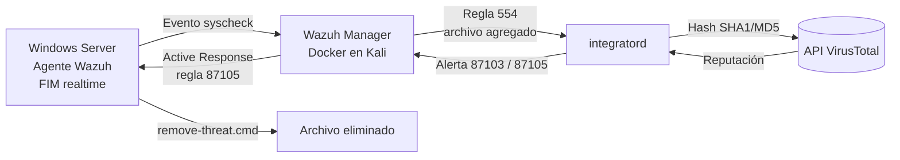

# Threat Intelligence Integration: Wazuh + VirusTotal + Active Response

Laboratorio de **XDR / Cyber Threat Intelligence** que enriquece automáticamente las alertas de File Integrity Monitoring (FIM) de Wazuh con la reputación de VirusTotal y **elimina de forma automática** los archivos detectados como maliciosos en un endpoint Windows.

> **Resultado:** un archivo malicioso aparece en `Downloads` → Wazuh lo detecta en tiempo real → consulta VirusTotal → 63 de 67 motores lo marcan → el archivo se elimina solo, sin intervención humana.

---

## Tabla de contenidos

1. [Objetivo](#objetivo)
2. [Arquitectura](#arquitectura)
3. [Entorno del laboratorio](#entorno-del-laboratorio)
4. [Implementación](#implementación)
5. [Pruebas y evidencia](#pruebas-y-evidencia)
6. [Troubleshooting (problemas reales y cómo se resolvieron)](#troubleshooting)
7. [Limitaciones](#limitaciones)
8. [Mejoras futuras](#mejoras-futuras)
9. [Aprendizajes](#aprendizajes)
10. [Seguridad del repositorio](#seguridad-del-repositorio)

---

## Objetivo

Automatizar el flujo **detección → enriquecimiento → respuesta** que se ve en un SOC real:

| Etapa | Qué hace | Componente |
|---|---|---|
| Detección | Detecta archivos nuevos o modificados en tiempo real | Wazuh FIM (syscheck) |
| Enriquecimiento | Consulta la reputación del hash del archivo | Integración con la API de VirusTotal |
| Respuesta | Elimina el archivo si fue marcado como malicioso | Active Response (script propio) |

---

## Arquitectura



Flujo resumido:

```
FIM (syscheck realtime) → alerta 554 → integratord → API VirusTotal → alerta 87105 → Active Response → archivo eliminado
```

---

## Entorno del laboratorio

| Componente | Detalle |
|---|---|
| Wazuh Manager | Docker, despliegue oficial `single-node` (`wazuh-docker`) sobre Kali Linux |
| Endpoint | Windows Server (`windowser`) con agente Wazuh 4.x |
| Red | Máquinas virtuales en red NAT (`10.0.2.0/24`) |
| Threat Intelligence | API de VirusTotal (cuenta gratuita) |
| Archivo de prueba | EICAR (archivo estándar de prueba de antivirus, inofensivo) |

---

## Implementación

### 1. Integración con VirusTotal (manager)

Con el despliegue Docker oficial, el manager monta su configuración como *bind mount*. Por eso la configuración se edita en el **archivo de origen**, no dentro del volumen de Docker:

```bash
cd ~/wazuh-docker/single-node
sudo nano config/wazuh_cluster/wazuh_manager.conf
```

Dentro del bloque `<ossec_config>` principal:

```xml
<integration>
  <name>virustotal</name>
  <api_key>TU_API_KEY</api_key>
  <group>syscheck</group>
  <alert_format>json</alert_format>
</integration>
```

Validar y reiniciar:

```bash
xmllint --noout config/wazuh_cluster/wazuh_manager.conf
sudo docker restart single-node-wazuh.manager-1
sudo docker exec -it single-node-wazuh.manager-1 grep -i integratord /var/ossec/logs/ossec.log | tail -3
```

Resultado esperado en el log:

```
wazuh-integratord: INFO: Started (pid: ...).
wazuh-integratord: INFO: Enabling integration for: 'virustotal'.
```

### 2. FIM en tiempo real (agente Windows)

En `C:\Program Files (x86)\ossec-agent\ossec.conf`:

```xml
<syscheck>
  <disabled>no</disabled>
  <frequency>43200</frequency>
  <scan_on_start>yes</scan_on_start>
  <directories realtime="yes" check_all="yes">C:\Users\Administrador\Downloads</directories>
</syscheck>
```

Reiniciar el agente:

```powershell
Restart-Service -Name wazuh
```

### 3. Active Response (eliminación automática)

El agente Windows **no incluye** un `remove-threat.exe` por defecto (solo `netsh.exe`, `restart-wazuh.exe` y `route-null.exe`), así que se creó un script propio.

**En el manager** (`wazuh_manager.conf`, antes del `</ossec_config>` final):

```xml
<command>
  <name>remove-threat</name>
  <executable>remove-threat.cmd</executable>
  <timeout_allowed>no</timeout_allowed>
</command>

<active-response>
  <disabled>no</disabled>
  <command>remove-threat</command>
  <location>local</location>
  <rules_id>87105</rules_id>
</active-response>
```

La regla `87105` es la detección positiva de VirusTotal. Se evita usar `87103` ("no records") para no borrar archivos simplemente desconocidos.

**En el agente Windows**, carpeta `C:\Program Files (x86)\ossec-agent\active-response\bin\`:

`remove-threat.cmd`

```bat
@echo off
powershell.exe -NoProfile -ExecutionPolicy Bypass -File "%~dp0remove-threat.ps1"
```

`remove-threat.ps1`

```powershell
$logfile = "C:\Program Files (x86)\ossec-agent\active-response\active-responses.log"
$inputJson = [Console]::In.ReadLine() | ConvertFrom-Json
$file = $inputJson.parameters.alert.data.virustotal.source.file

function Log($msg) {
  Add-Content -Path $logfile -Value "$(Get-Date -Format 'yyyy/MM/dd HH:mm:ss') remove-threat: $msg"
}

if ($file -and (Test-Path -LiteralPath $file)) {
  try {
    Remove-Item -LiteralPath $file -Force -ErrorAction Stop
    Log "Successfully removed threat: $file"
  } catch {
    Log "Error removing threat: $file - $($_.Exception.Message)"
  }
} else {
  Log "File already removed or not found: $file"
}
```

El script lee por stdin el JSON de la alerta que envía Wazuh y toma la ruta del campo `data.virustotal.source.file`.

---

## Pruebas y evidencia

> Reemplazá las rutas de imagen por tus capturas (tapá IPs, nombres de equipo y cualquier API key).

### Prueba 1: archivo desconocido (sin registros en VirusTotal)

```powershell
Set-Content -Path "C:\Users\Administrador\Downloads\prueba1.txt" -Value "hola wazuh"
```

Resultado: alerta `87103` con `found: 0`. Es el comportamiento correcto: un archivo único nunca fue subido a VirusTotal.


### Prueba 2: archivo malicioso (EICAR)

```powershell
Add-MpPreference -ExclusionPath "C:\Users\Administrador\Downloads"   # solo en la VM de laboratorio
Set-Content -Path "C:\Users\Administrador\Downloads\eicar.txt" -Value 'X5O!P%@AP[4\PZX54(P^)7CC)7}$EICAR-STANDARD-ANTIVIRUS-TEST-FILE!$H+H*'
```

Resultado: alerta `87105`, nivel 12, **63 de 67 motores** detectaron el archivo, mapeada a MITRE ATT&CK **T1203** (Exploitation for Client Execution).


> Nota: `data.virustotal.malicious: 1` es un indicador binario de Wazuh. El número real de detecciones está en `data.virustotal.positives`.

### Prueba 3: eliminación automática

Con el Active Response configurado, se creó `eicar3.txt` y 40 segundos después:

```powershell
Test-Path "C:\Users\Administrador\Downloads\eicar3.txt"
# False
```

Log del agente (`active-responses.log`):

```
remove-threat: Successfully removed threat: c:\users\administrador\downloads\eicar3.txt
```


Cadena de eventos verificada en el dashboard:

| Orden | Regla | Descripción |
|---|---|---|
| 1 | `554` | File added to the system (syscheck) |
| 2 | `87105` | VirusTotal: 63 engines detected this file |
| 3 | Active Response | El agente ejecuta `remove-threat.cmd` y elimina el archivo |

---

## Troubleshooting

Esta sección documenta los problemas reales del laboratorio y cómo se diagnosticaron.

### Problema 1: la configuración volvía a su estado anterior tras reiniciar

- **Síntoma:** al editar `ossec.conf` en el volumen de Docker, el cambio desaparecía al reiniciar el contenedor, y el archivo aparecía con un bloque `<ossec_config>` duplicado.
- **Pista en el log:** `wazuh-integratord: INFO: Remote integrations not configured. Clean exit.`
- **Causa:** el `docker-compose.yml` monta `config/wazuh_cluster/wazuh_manager.conf` en `/wazuh-config-mount/etc/ossec.conf`, y el entrypoint lo copia sobre `/var/ossec/etc/ossec.conf` en cada arranque, pisando lo editado en el volumen.
- **Solución:** editar siempre el archivo de origen del bind mount.

### Problema 2: bloque de configuración fuera de `</ossec_config>`

- **Síntoma:** la integración y el active response no se cargaban.
- **Causa:** los bloques se pegaron después del `</ossec_config>` de cierre.
- **Solución:** mover el cierre al final del archivo y validar con `xmllint --noout`.

### Problema 3: la integración no se disparaba

- **Causa:** `<group>syscheck</group>` solo reacciona a alertas de FIM, y no había ningún agente generándolas (todas las alertas eran del propio manager, `agent.id: 000`).
- **Solución:** conectar el agente Windows y configurar FIM en tiempo real sobre `Downloads`.

### Problema 4: el Active Response no se ejecutaba

- **Síntoma:** llegaban la `554` y la `87105`, pero el archivo no se borraba.
- **Pista en el log del agente (`ossec.log`):** `Active response command not present: 'active-response/bin/remove-threat.exe'. Not using it on this system.`
- **Causa:** el agente Windows no trae `remove-threat.exe`.
- **Solución:** script propio `.cmd` + `.ps1` (ver [Implementación](#3-active-response-eliminación-automática)) y cambio de `<executable>` en el manager.

### Observación: ejecución duplicada

El script se ejecutó dos veces para el mismo archivo con 2 segundos de diferencia: la primera lo borró y la segunda no lo encontró. Se debe a que la regla `87105` puede dispararse más de una vez por archivo (eventos de creación y modificación). Es inofensivo, y el script lo registra como informativo.

---

## Limitaciones

- **Borrado sin cuarentena:** un falso positivo de VirusTotal eliminaría un archivo legítimo sin posibilidad de recuperarlo. En producción se usaría un umbral mínimo de detecciones o se movería el archivo a cuarentena.
- **Cuota de la API gratuita de VirusTotal:** 4 consultas por minuto y 500 por día; ráfagas de archivos generan errores de cuota.
- **Cobertura de FIM:** solo se monitorea `Downloads`. Un atacante que escriba en otra ruta no sería detectado.
- **Defender excluido en la prueba:** para que Windows Defender no borre el EICAR antes que Wazuh, se excluyó la carpeta. Esto solo es válido en un laboratorio.
- **Consulta por hash:** VirusTotal solo conoce muestras ya vistas. Malware nuevo o modificado devuelve `No records`.
- **Alerta de confirmación:** la alerta de Wazuh que confirma el borrado (reglas custom sobre la `657`) no quedó validada en este laboratorio.

---

## Mejoras futuras

- Mover el archivo a **cuarentena** en lugar de eliminarlo.
- Exigir un **umbral de detecciones** antes de actuar (por ejemplo, más de 5 motores).
- Agregar reglas custom para generar una **alerta de confirmación** del borrado en el dashboard.
- Sumar **Sysmon** para detectar ejecuciones, no solo creación de archivos.
- Ampliar FIM a más rutas (`Temp`, `AppData`, `Desktop`).
- Guardar la API key fuera del archivo versionado (variables de entorno o secrets de Docker).

---

## Aprendizajes

- Cómo se comporta Wazuh en Docker con bind mounts y por qué las ediciones directas al volumen se pierden.
- Diagnóstico con logs de ambos extremos: `ossec.log` del manager (`integratord`) y del agente (`active-response`).
- Flujo completo de FIM → CTI → respuesta automatizada.
- Mapeo de detecciones a MITRE ATT&CK.
- Diferencia entre un resultado "desconocido" (`87103`) y uno "malicioso" (`87105`) en threat intelligence.
- Riesgos de automatizar respuestas destructivas sin umbrales ni cuarentena.

---

## Seguridad del repositorio

- **No subas la API key de VirusTotal.** En los archivos de ejemplo usá siempre `TU_API_KEY`.
- Agregá tu configuración real al `.gitignore`:

```gitignore
config/wazuh_cluster/wazuh_manager.conf
*.env
```

- Revisá las capturas antes de publicarlas: tapá IPs, nombres de equipo y claves.
- El archivo EICAR es inofensivo, pero ejecutá estas pruebas **solo en un entorno aislado** donde puedas excluir Defender sin riesgo.

---

## Referencias

- [Documentación de Wazuh: integración con VirusTotal](https://documentation.wazuh.com/current/proof-of-concept-guide/detect-remove-malware-virustotal.html)
- [Wazuh Docker deployment](https://github.com/wazuh/wazuh-docker)
- [VirusTotal API](https://docs.virustotal.com/reference/overview)
- [MITRE ATT&CK T1203](https://attack.mitre.org/techniques/T1203/)

---

**Autor:** _tu nombre_ · [GitHub](https://github.com/TU_USUARIO) · [LinkedIn](https://www.linkedin.com/in/TU_USUARIO)
